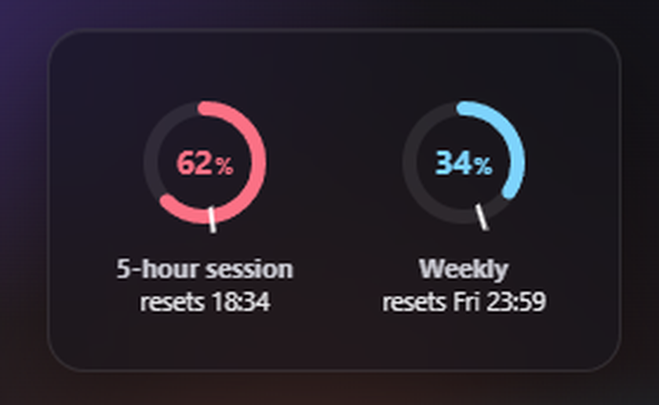

# Claude Limit Checker

[English](README.md) | Français

> **Non officiel, sans lien avec Anthropic.** C'est un projet personnel indépendant.



Un petit widget Windows, toujours au premier plan, qui affiche d'un coup d'œil vos limites d'utilisation de claude.ai.

## Ce qu'il affiche

Deux anneaux, actualisés toutes les 30 secondes :

- **Session de 5 heures** : la part de la fenêtre de 5 heures en cours que vous avez consommée, et l'heure de sa réinitialisation.
- **Semaine** : la part de votre limite sur 7 jours consommée, et la date de sa réinitialisation.

Le **trait blanc** sur chaque anneau indique où vous en seriez si vous consommiez votre quota à rythme
régulier jusqu'à la réinitialisation. La couleur de l'anneau compare votre consommation réelle à ce rythme :

| Couleur | Signification |
| --- | --- |
| Rouge | En avance sur le rythme : vous consommez plus vite qu'un rythme régulier (plus de 5 points au-dessus) |
| Vert | Dans le rythme (à moins de 5 points du trait) |
| Bleu | De la marge : vous êtes en retard sur le rythme (plus de 5 points sous le trait) |
| Gris | Inactif : aucune fenêtre de session n'est en cours |

## Prérequis

- **Windows 10 ou 11**
- **Firefox**, avec une session ouverte sur claude.ai. Firefox est pour l'instant le seul navigateur pris en charge.

## Installation

Téléchargez l'installateur (`.exe`) depuis la [page des versions](https://github.com/Azgoum/ClaudeUsageWindow/releases)
puis lancez-le.

Vous préférez ne rien installer ? La même page propose une **version portable** (`limitrings-windows-x64.zip`) :
décompressez-la où vous voulez et lancez `limitrings.exe`. Il faut le runtime WebView2, normalement déjà présent
sur Windows 10 et 11.

Les versions ne sont **pas signées** : un certificat de signature de code coûte cher chaque année, et ceci est un
projet libre et gratuit. Windows SmartScreen affichera donc un avertissement (« Windows a protégé votre PC »).
Cliquez sur **Informations complémentaires**, puis sur **Exécuter quand même**. Si vous préférez, vous pouvez
[compiler depuis les sources](#compiler-depuis-les-sources) et relire le code.

## Connexion

Au premier lancement, cliquez sur **Se connecter**. L'application ouvre Firefox sur claude.ai si besoin et
attend que vous soyez connecté.

Ce qui est lu, précisément : les **cookies claude.ai de votre profil Firefox** (le fichier `cookies.sqlite`,
copié dans un fichier temporaire car Firefox le verrouille). Rien d'autre dans votre profil n'est touché. Les
cookies sont ensuite stockés dans le **Gestionnaire d'informations d'identification de Windows**, jamais dans
un fichier en clair, et ne sont **envoyés qu'à claude.ai**. « Se déconnecter » dans le menu les supprime.

## Désinstallation

**Choisissez « Se déconnecter » dans le menu avant de désinstaller.** Le désinstalleur (ou la suppression du
dossier portable) retire l'application, mais pas la session enregistrée dans le Gestionnaire d'informations
d'identification (entrées nommées `limitrings`), ni le lancement au démarrage de Windows. Donc : décochez
**Lancer au démarrage de Windows**, choisissez **Se déconnecter**, puis désinstallez. Déjà désinstallé ?
Supprimez à la main les entrées `limitrings` du Gestionnaire d'informations d'identification et la valeur
`limitrings` sous `HKCU\Software\Microsoft\Windows\CurrentVersion\Run`.

## À savoir : point d'accès non documenté, conditions d'utilisation

Claude Limit Checker utilise un **point d'accès claude.ai non documenté**, le même que celui de la page
d'utilisation de vos paramètres. Il peut changer ou cesser de fonctionner à tout moment, sans préavis. Utiliser
la session de votre navigateur depuis une application tierce se situe aussi dans une **zone grise des conditions
d'utilisation d'Anthropic**. À utiliser à vos risques.

## Confidentialité

Aucune télémétrie, aucune statistique, aucun compte. Le seul trafic réseau va vers `https://claude.ai`.
Les réglages sont dans `%APPDATA%\limitrings\`, les journaux dans `%LOCALAPPDATA%\limitrings\logs\` (les valeurs
des cookies n'y figurent jamais).

## Compiler depuis les sources

Prérequis : Rust (toolchain MSVC), Node 22 et `cargo install tauri-cli --version "^2" --locked`.

```sh
cd ui && npm ci && cd ..
cargo tauri build      # installateur dans target/release/bundle/nsis/
```

Tests : `cargo test --workspace`, puis `npm test -- --run` et `npx tsc --noEmit` dans `ui/`.

Pour développer sans vrai compte claude.ai, lancez le faux serveur scripté
(voir [tools/fake-claude/README.md](tools/fake-claude/README.md)) :

```sh
node tools/fake-claude/server.mjs
```

## Licence

[MIT](LICENSE) © 2026 Aziz Goumiri
