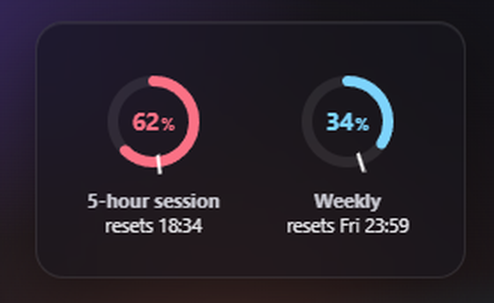

# Claude Limit Checker

English | [Français](README.fr.md)

> **Unofficial, not affiliated with Anthropic.** This is an independent hobby project.



A small always-on-top Windows widget that shows your claude.ai usage limits at a glance.

## What it shows

Two rings, refreshed every 30 seconds:

- **5-hour session**: how much of the current 5-hour window you have used, and when it resets.
- **Weekly**: how much of your 7-day limit you have used, and when it resets.

The white **tick** on each ring marks where you would be if you used your allowance at an even pace
until the reset. The ring color compares your actual usage to that pace:

| Color | Meaning |
| --- | --- |
| Red | Ahead of pace: you are using it faster than an even pace (more than 5 points ahead) |
| Green | On track (within 5 points of the tick) |
| Blue | Room left: you are behind pace (more than 5 points under the tick) |
| Gray | Idle: no session window is currently running |

## Requirements

- **Windows 10 or 11**
- **Firefox**, signed in to claude.ai. Firefox is the only supported browser for now.

## Install

Download `ClaudeLimitChecker.exe` from the [Releases page](https://github.com/Azgoum/ClaudeUsageWindow/releases)
and run it. There is no installer: it is a single file with nothing else to install.

Prefer an archive? The same page has `ClaudeLimitChecker-windows-x64.zip`, which contains the same exe.

**Start with Windows is off by default.** If you turn it on, move the exe somewhere permanent first (for
example `%LOCALAPPDATA%\Programs\`), because it registers the exe where it sits.

Releases are **not code-signed**: a code-signing certificate costs money every year, and this is a free
open-source side project. Windows SmartScreen will therefore warn you ("Windows protected your PC").
Click **More info**, then **Run anyway**. If you prefer, [build it from source](#build-from-source) and
check the code yourself.

## Connect

On first launch, click **Connect**. The app opens Firefox on claude.ai if needed and waits for you to be
signed in.

Exactly what is read: the **claude.ai cookies from your Firefox profile** (the `cookies.sqlite` file, copied
to a temporary file because Firefox locks it). Nothing else in your profile is touched. The cookies are
then stored in **Windows Credential Manager**, never in a plain file, and are **sent only to claude.ai**.
"Disconnect" in the menu deletes them.

## Uninstall

**Choose Disconnect in the menu before deleting the exe.** Deleting it removes the app, but not the stored
session in Credential Manager (the `limitrings` entry) nor the "Start with Windows" entry. So: turn off
**Start with Windows**, choose **Disconnect**, then delete the exe. Optionally, also delete the
`%APPDATA%\limitrings` folder (settings) and `%LOCALAPPDATA%\limitrings` (logs).
Already deleted the exe? Delete the `limitrings` entry in Credential Manager and the `limitrings` value under
`HKCU\Software\Microsoft\Windows\CurrentVersion\Run` by hand.

## Heads up: undocumented endpoint, terms of service

Claude Limit Checker uses an **undocumented claude.ai endpoint**, the same one the usage page in
your settings uses. It can change or break at any time without notice. Using your browser session
from a third-party app also sits in a **gray area of Anthropic's terms of service**. Use it at your
own risk.

## Privacy

No telemetry, no analytics, no accounts. The only network traffic goes to `https://claude.ai`.
Settings live in `%APPDATA%\limitrings\`, logs in `%LOCALAPPDATA%\limitrings\logs\` (cookie values are
never logged).

## Build from source

Requirements: Rust (MSVC toolchain). Nothing else.

```sh
cargo build --release -p limitrings    # target/release/limitrings.exe
```

Tests: `cargo test --workspace`.

For development without a real claude.ai account, run the scripted fake server
(see [tools/fake-claude/README.md](tools/fake-claude/README.md)), which needs Node 22:

```sh
node tools/fake-claude/server.mjs
```

## License

[MIT](LICENSE) © 2026 Aziz Goumiri
